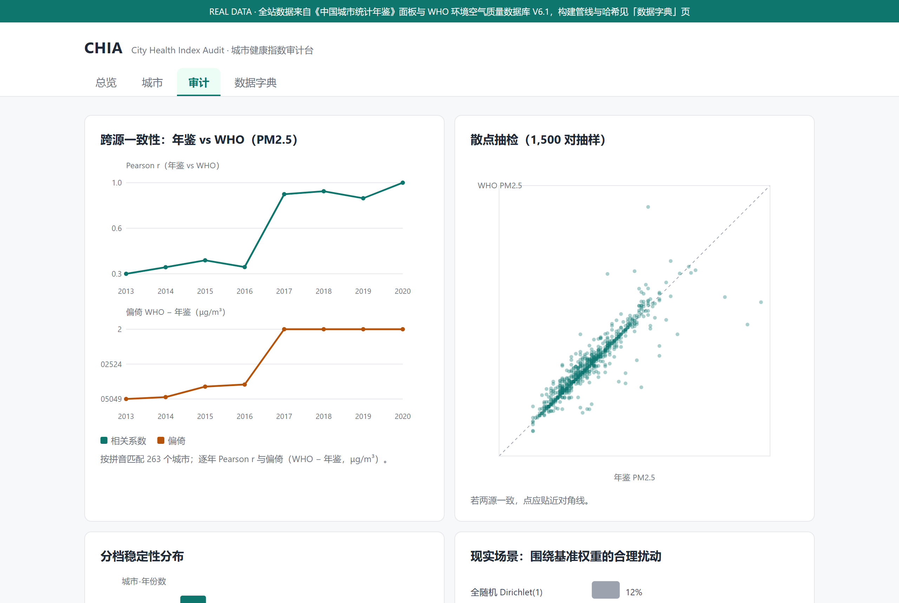

# 城市健康指数审计台 / City Health Index Audit (CHIA)

> **An open-source measurement audit of in-use city health indices — not another city ranking.**
> 对「在用的城市健康指数」做测量学审计的开源工具与可复现网站。**不发布城市排名。**

[](#)
[](#数据声明)
[](LICENSE)

**English version: [README.en.md](README.en.md)**（English README is a condensed summary; 中文版为权威版本）



---

## 审计对象与边界（先说清楚）

本仓库当前审计对象分两层：

1. **直接审计（v0.6.0 新增）**：TUHI 官网公开的 **2020–2025 年全部 296 个参评城市总分**（官方接口快照随仓库分发，来源与核验见 `data/raw/SOURCE.md` 第 4 节）。审计内容为收敛效度与档位交叉对照——**仅用于测量学审计，不以任何形式重构、替代或再分发 TUHI 指数本身**。
2. **参考实现审计**：按在用指数公开框架、用《城市统计年鉴》真实数据透明重建的 21 指标指数（302 城 × 2003–2024）+ WHO 跨源校验。

在完成之前——现在已完成第 1 层——本站构造稳健性结论只针对「TUHI 型指数」这一类构造方式，不针对 TUHI 的任何具体发布数值的解释权。

---

## 数据声明 / Data notice（请先读）

**本站与 `docs/data/` 中所有数值均为真实公开数据计算结果，无任何模拟数据。** 两个来源：

1. **《中国城市统计年鉴》双源面板（2003–2024）**：旧版 1999–2018 公开汇编（.dta）+ 2020–2025 卷分表 Excel 提取（`scripts/extract_new_yearbook.py`，重叠年 15 项字段逐字节吻合），合并为 **302 个地级市 × 2003–2024 年 × 21 项透明可复算指标**，是指数与分档的唯一输入。
2. **WHO Ambient Air Quality Database V6.1（2024 年 1 月更新）**：作为独立第二数据源，对年鉴 PM2.5 做跨源一致性审计（拼音匹配 263 城；最新可用年 2020 年 r=0.976、MAPE 2.4%）。

- 来源、引用与哈希校验见 [`data/raw/SOURCE.md`](data/raw/SOURCE.md)；两份原始文件随仓库分发以保可复现。
- 本仓库**不包含**任何个体级疾病监测、电子病历、医保结算或部门报送明细数据。
- **结局锚缺口如实呈现**：开放数据下地级市死亡率/发病率不可得，本演示不含疾病结局维度，不做代理填补（见网站总览的缺口标注）。
- 三层数据管理（L1 公开 / L2 申请 / L3 不公开）见 [`docs/DATA_AVAILABILITY.md`](docs/DATA_AVAILABILITY.md)。

---

## 为什么做这个

政策端已高强度使用城市健康指数：清华城市健康指数（TUHI）连续多年覆盖 296 个地级以上城市、六大板块、分档并公布分组排名；2018 版《全国健康城市评价指标体系》用于考核。但这些体系的「健康效用 / 健康人群」板块把**健康结局**与**决定因素**一起加权求总分，随后又用「指数上升」论证健康改善——结构上存在「用结果解释结果」的循环论证。

查重显示：复合指数以健康结局作外部效标（ADI/SDI 传统）、Monte Carlo 权重不确定性（COINr）、健康城市试点政策评估（已有 4 篇 DID）都已有成熟工作；**但对在用中国城市健康指数的外部效标审计、对「结局入分」后果的量化、以及指数本身的响应效度，在检索范围内未见**。

本项目不造一个新指数，而是回答三个问题：

1. 在用的指数具备可检验的结构效度吗？——用真实面板做跨源一致性、覆盖率、数据谱系审计与已知组效度检验（东中西/试点）；
2. 分档在权重、标准化、聚合等构造选择下稳定吗？——真实 Monte Carlo（5,000 次 Dirichlet 全随机参照系 + 围绕基准 ±20%/±50% 合理扰动）给出每个城市-年的分档稳定率与转移矩阵；
3. 哪类构造选择最影响结论？——真实方差分解：归一化口径 > 维间权重 > 维内权重（确证 Saisana et al. 2005）。

---

## 与 TUHI 官网刻意做得不一样

| TUHI 官网 | 本审计台 |
|---|---|
| 首页给精确名次与分数 | **不排名**：只给分档 + 分档稳定性概率，同档内不排序 |
| 回答「谁更健康」 | 回答「**这个分数可信吗**」：跨源一致性、覆盖率、构造敏感性 |
| 单一确定性分数 | 真实 Monte Carlo **分档稳定性** + 方差分解 |
| 指标清单 | 每指标附**公式与覆盖率**：来源列、换算式、缺失率一目了然 |
| 年度报告与地图 | **数据谱系 + 复现命令 + SHA256 校验**；不做地图、不做精确名次 |
| 原始数据不公开 | 两份公开原始数据**随仓库分发**，`fetch_data.py` 带哈希校验 |

> 设计立场：一个为「排名」优化的产品和一个为「可核查性」优化的产品，界面必然不同。我们刻意去掉名次与地图，避免排名误读，也避开地图数据合规风险。

---

## 快速开始

```bash
git clone <THIS_REPO_URL>
cd city-health-audit

# 直接打开网站（无需服务器、无需网络）
#   Windows: start docs/index.html
#   macOS:   open docs/index.html
#   Linux:   xdg-open docs/index.html

# 或从原始数据一键重建全部输出（需要 Python 3.10+ 与 pandas/openpyxl/pypinyin）
python scripts/fetch_data.py      # 校验（必要时重新下载）两份原始数据
python scripts/build_data.py      # 重建面板、指数、审计与网页数据

# 本地预览
python -m http.server 8000 --directory docs
# 浏览器打开 http://localhost:8000
```

GitHub Pages：把 Pages 源设为 `docs/` 目录即可，网站为纯静态、离线可运行。

---

## 目录结构

```
city-health-audit/
├── docs/
│   ├── index.html                  # 审计台网站（GitHub Pages 入口，4 视图）
│   ├── assets/style.css, app.js    # 纯原生，无 CDN 依赖
│   ├── data/*.js                   # 网站数据（真实数据 + 指标字典）
│   ├── PAPER_PLAN.md               # SCI 布局：P1/P2/P3、终点、期刊、tag 策略
│   ├── METHODS.md                  # 审计框架与统计方法
│   ├── DATA_AVAILABILITY.md        # 三层数据可得性声明
│   └── REPRODUCE.md                # 一键复现与版本冻结
├── data/
│   ├── raw/                        # 两份公开原始数据 + SOURCE.md（引用与哈希）
│   └── processed/                  # 构建产物：面板、跨源审计、覆盖率、摘要
├── dict/
│   ├── indicator_dictionary.csv    # 21 项真实指标字典（公式与覆盖率）
│   └── metadata_schema.yaml        # 元数据字段规范
├── scripts/
│   ├── fetch_data.py               # 下载 + SHA256 校验原始数据
│   └── build_data.py               # 全量构建管线（真实数据，固定种子）
├── analysis/preregistration.md     # OSF 预注册草案
├── packages/chuhi/                 # R 包骨架（COINr 上层效度审计层）
├── .github/workflows/ci.yml        # 真实数据重建可复现 + 公开合规自检
├── PUBLISH.md                      # 公开自检清单与发布命令
└── README / LICENSE / CITATION.cff / CONTRIBUTING / CODE_OF_CONDUCT / CHANGELOG
```

---

## 主要真实发现（演示口径）

- **与 TUHI 发布结果直接对照（v0.6.0，本项目最强证据）**：TUHI 官网公开的 296 城总分与本参考实现**排序高度收敛**（TUHI 2020–2025 各年 Spearman 0.69–0.78，均值 0.74；1,776 个城市-年对）——两套独立数据、独立框架的指数测的是同一个东西；**但档位标签一致率仅 6.8%–30.7%**（二次加权 kappa 0.21–0.58）。头部惊人地一致（TUHI 引领级中 98.4% 落入本实现 A 档），中后段却系统性错位——**两套都合理的构造给同一城市贴的档位经常不同**，这是「指数只能分档呈现、且档位必须附带不确定性」最直接的实证。
- **跨源一致性高且逐年改善**：年鉴 PM2.5 × WHO 独立测量 263 城匹配，2020 年 r=0.976、偏仅 -0.09 μg/m³、MAPE 2.4%（早年 2018 年 r=0.905、MAPE 7.9%）——两源可互为补充，但不可混用。
- **分档远比想象中不稳**：完全随机的 Dirichlet 权重抽样（5,000 次，「对权重完全无知」的参照系）下，仅约 12% 的城市-年分档稳定率 ≥0.8；**中间档（B/C/D）尤其不可靠**——转移矩阵显示其稳定率仅 24–31%，极端档 A/E 为 63–67%。
- **现实场景同样不稳**：即使权重只在基准（等权）附近波动 ±20%，仍有约 41.5% 的城市-年档位不稳固；±50% 时升至约 67%。
- **换一套「合理且常见」的构造方案，九成城市变档**：熵权维内方案下与基准档位一致的城市仅 7.0%，逐年百分位归一方案下仅 10.3%（2024 年截面 302 城）。网站城市画像可逐城查看「换方案看档位」。
- **已知组效度成立**（无需结局锚即可执行的区分度检验）：东/中/西总分梯度 53.1/44.3/42.7（东-西 Hedges g=0.64，p<0.0001），且维度梯度符合理论预期——经济与设施梯度最强、**环境维度梯度最弱（g=0.26）**，恰是指数该有的样子。试点 vs 非试点 g=1.45 **主要是遴选的选择效应，不能解读为政策效果**。
- **构造选择很关键（确证性结果）**：全国均分方差分解显示归一化口径 > 维间权重 > 维内权重——与复合指标敏感性分析文献（Saisana et al. 2005；OECD/JRC 手册）方向一致，本项目予以确证而非首创。
- **总分口径**：总分为逐年截面重标定的 0–100 相对分（当年最高=100、最低=0），跨年比较是相对位置变化；合成前原值保留在 `overall_raw`。
- **结局锚是公开数据的真实缺口**：地级市死亡率/发病率不可得，这恰是「结局入分循环论证」难以被外部审计的根源。

以上为演示口径下的真实计算结果；正式结论须按 `docs/METHODS.md` 补充结局锚数据与预注册后得出。

---

## SCI 布局（谋划中，文章后置）

| 论文 | 方向 | 目标期刊（档位） |
|---|---|---|
| **P1** | 结局入分是否虚高效标效度：含/不含 D1 对照审计 | *Health & Place* / *IJHG* / *BMC Public Health*；冲刺 *Soc Sci Med* / *Lancet Reg Health – West Pac* |
| **P2** | 开源验证工具与真实数据基准 | *JOSS* / *The R Journal* / *Scientific Data* |
| **P3** | 城市健康指数的响应效度（检验工具，非检验政策） | *J Urban Health* / *Cities* |

完整终点定义、审稿人备答、数据可得性语句模板与代码 tag 策略见 [`docs/PAPER_PLAN.md`](docs/PAPER_PLAN.md)。**原则：文章后置，不因投稿节奏倒逼数据或结论。**

---

## 路线图

- [x] 新颖性查重与 pivot 决策（2026-11-10）
- [x] 公开仓库骨架 + 审计台网站（M0）
- [x] **真实开放数据接入并扩展到 2024 年**：城市统计年鉴 302 城 × 2003–2024（双源拼接）+ WHO 跨源审计（M1）
- [x] **审计内容扩展 v0.5.0**：权重扰动情景（±20%/±50%）、熵权/逐年百分位情景对比、分档转移矩阵、已知组效度（东中西 + 试点）、网站「换方案看档位」交互、Node 冒烟测试进 CI
- [x] **TUHI 发布分数/档位的直接审计（v0.6.0）**：官方接口 2020–2025 全部 296 城快照入库，收敛效度 ρ≈0.74、档位交叉对照、分歧案例清单；审计对象边界升级为双层
- [ ] OSF 预注册正式提交、Zenodo DOI 归档
- [ ] 中文系统检索（CNKI/万方/维普）+ PRISMA-ScR 新颖性声明
- [ ] `chuhi` R 包函数完善与单元测试
- [ ] L2 真实数据接入（疾病监测/结局锚）→ P1 主分析
- [ ] P1 / P2 / P3 按数据成熟度投稿

---

## 引用

如使用本仓库，请引用 `CITATION.cff`；数据来源引用见 `data/raw/SOURCE.md`。相关学术依据见 [`docs/METHODS.md`](docs/METHODS.md) 与项目上级目录 `01_文献与证据/` 的已核验文献库。

本项目与清华城市健康指数（TUHI）、2018 版国家指标体系为**审计 / 互补**关系，非竞争或替代；本站不发布任何城市排名。

---

## 许可证与贡献

- 代码：[MIT](LICENSE)；文档与指标字典：CC BY 4.0；派生数据：ODbL 1.0。
- 原始数据的再分发以原始发布方条款为准（见 `data/raw/SOURCE.md`）。
- 贡献指南见 [CONTRIBUTING.md](CONTRIBUTING.md)，行为准则见 [CODE_OF_CONDUCT.md](CODE_OF_CONDUCT.md)。
- 欢迎 issue / PR，尤其是指标口径勘误、效度检验方法改进与可复现性修复。

**四条禁令**（写入发布规范）：不把分档做成精确名次；不用市级总分推断个体风险；不把复合总分当作因果证据；不因「数据可得」而增删理论框架中的维度（不可得指标登记为缺口，不静默删除）。
